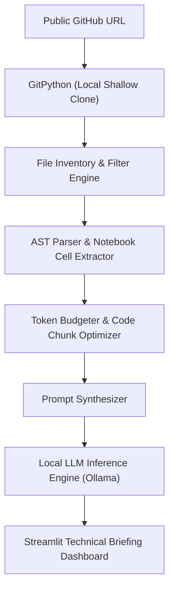

# 🔍 CodeLens AI — Local GitHub Repository Intelligence

<p align="center">
  
</p>

<p align="center">
  A local generative AI developer tool that clones public GitHub repositories, analyzes dependency graphs, parses Python abstract syntax trees (ASTs) and Jupyter notebook code cells, and generates comprehensive technical briefings using local LLMs (via Ollama).
</p>

<p align="center">
  <a href="https://github.com/prakruthidevanga/GitHub-Repo-Explainer">
    
  </a>
</p>

<p align="center">
  
  
  
  
</p>

---

## 📌 Table of Contents

- [📖 Project Overview](#-project-overview)
- [🎯 Objectives](#-objectives)
- [✨ Key Features](#-key-features)
- [🏗️ Code Processing Pipeline](#️-code-processing-pipeline)
- [🛠️ Technology Stack](#️-technology-stack)
- [📁 Repository Structure](#-repository-structure)
- [⚙️ Installation and Setup](#️-installation-and-setup)
- [🔮 Future Enhancements](#-future-enhancements)
- [🤝 Contributing](#-contributing)
- [👩‍💻 Author & Accreditations](#-author--accreditations)

---

## 📖 Project Overview

Developers and open-source contributors spend significant time familiarizing themselves with unfamiliar codebases. Documentation is often sparse, outdated, or absent, and feeding entire multi-file repositories into cloud-hosted AI APIs quickly exceeds token context windows and risks leaking proprietary code to third parties.

**CodeLens AI (GitHub-Repo-Explainer)** solves this developer bottleneck. It clones any public GitHub repository into a sandboxed local workspace, conducts modular file-tree indexing, extracts code symbols and abstract syntax trees (ASTs), parses Jupyter notebook cells, and applies smart token budgeting to formulate context-aware prompts for local LLMs via **Ollama**.

🔍 **Core Mission:** Deliver instant, private, on-premise architectural briefings for any GitHub repository without cloud API subscriptions.

---

## 🎯 Objectives

- 📥 **Automated Sandboxed Cloning:** Seamlessly clone and inventory any public repository URL using GitPython.
- 🌳 **Abstract Syntax Tree (AST) Parsing:** Extract top-level classes, functions, and import dependencies to understand code structure.
- 📓 **Jupyter Notebook Extraction:** Parse `.ipynb` JSON trees to extract executable code cells alongside standard `.py` files.
- ⚖️ **Token Context Budgeting:** Intelligently prioritize and compress code snippets to fit within model context windows without overflow.
- 🔒 **100% Air-Gapped Privacy:** Execute all AI inferences through local Ollama instances with zero telemetry or data transmission.

---

## ✨ Key Features

### 📦 1. Repository Ingestion & Tree Inspection
Extracts clean, filtered directory trees while ignoring generated build artifacts (`node_modules`, `__pycache__`, `.venv`, `.git`).

### 🧩 2. AST Code Distillation
Analyzes function signatures, docstrings, and module dependency chains without cluttering the prompt with boilerplate syntax.

### 🧠 3. Multi-Section Architecture Briefing
Generates structured developer reports containing:
- **Executive Summary:** Core application purpose and target problem.
- **Technology Stack:** Detected languages, libraries, and frameworks.
- **Entry Points & Execution:** Primary entry scripts and startup instructions.
- **Key Modules & Responsibilities:** Breakdown of main classes and functions.

---

## 🏗️ Code Processing Pipeline



---

## 🛠️ Technology Stack

<p align="center">
  
</p>

| Component | Technology | Implementation Details |
| :--- | :--- | :--- |
| **Language & Environment** | Python 3.10+ | Core application runtime and type annotations |
| **Code Inspection** | GitPython, AST | Shallow repository cloning and syntax tree traversal |
| **Notebook Parsing** | JSON / nbformat | Code cell extraction from Jupyter notebooks |
| **AI Inference** | Ollama (Llama 3 / Mistral) | On-premise language model execution |
| **Web Presentation** | Streamlit & FastAPI | Interactive developer dashboard and REST endpoints |

---

## 📁 Repository Structure

```text
GitHub-Repo-Explainer/
├── core/
│   ├── repo_processor.py        # Cloning, filtering, and AST parsing
│   ├── llm.py                   # Local Ollama client connector
│   └── cloud_llm.py             # Optional fallback client
├── app.py                       # Streamlit interactive user interface
├── backend/
│   └── main.py                  # FastAPI companion REST service
├── requirements.txt             # Python dependency manifest
└── README.md                    # Project documentation
```

---

## ⚙️ Installation and Setup

### Prerequisites
- Python 3.10+
- Git installed on PATH
- [Ollama](https://ollama.ai/) installed with `llama3` or `mistral` pulled

### Step 1: Clone Repository
```bash
git clone https://github.com/prakruthidevanga/GitHub-Repo-Explainer.git
cd GitHub-Repo-Explainer
```

### Step 2: Set Up Virtual Environment
```bash
python -m venv .venv
.\.venv\Scripts\Activate.ps1
pip install -r requirements.txt
```

### Step 3: Run Ollama
```bash
ollama run llama3
```

### Step 4: Launch CodeLens AI
```bash
streamlit run app.py
```
*Open `http://localhost:8501`, enter any public GitHub URL, and generate your briefing!*

---

## 🔮 Future Enhancements

- 📊 **Call Graph Visualization:** Generate interactive dependency graphs showing cross-module function calls.
- 🧪 **Automated Test Scaffolding:** Suggest unit test cases based on parsed function signatures.
- 📦 **Multi-Language Expansion:** Add treesitter support for JavaScript, TypeScript, Go, and Java.

---

## 🤝 Contributing

Contributions are welcomed! Feel free to open an issue or submit a pull request with new AST extractors.

---

## 👩‍💻 Author & Accreditations

**Prakruthi B R**  
*BCA Student specializing in Artificial Intelligence & Machine Learning*  
*Alliance University, Bengaluru (CGPA: 9.60)*  
*GeeksforGeeks Campus Mantri (2026)*

- 💻 **GitHub:** [@prakruthidevanga](https://github.com/prakruthidevanga)
- 🔗 **LinkedIn:** [Prakruthi BR](https://linkedin.com/in/prakruthi-br)
- 🌐 **Portfolio:** [prakruthidevanga.github.io](https://prakruthidevanga.github.io/)
- 📬 **Email:** [prakruthibr2006@gmail.com](mailto:prakruthibr2006@gmail.com)

---

<p align="center">
  <b>🔍 Accelerating code comprehension through intelligent local AI.</b>
</p>

<p align="center">
  
</p>
